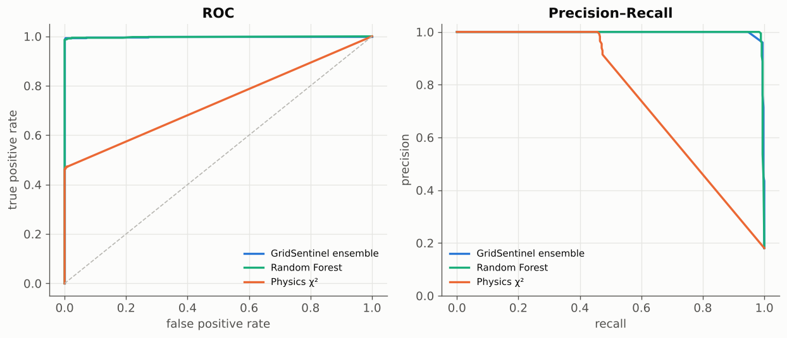
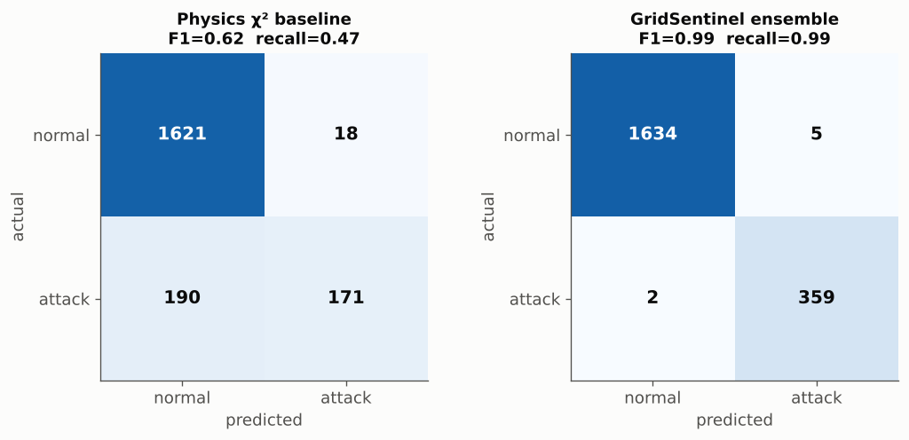

<div align="center">

# ⚡ GridSentinel

### Machine-learning detection of false-data injection in smart-grid substations

**A defensive research toolkit combining power-system state estimation, measurement analytics, and IEC 61850 GOOSE protocol signals to study synthetic grid attacks.**

[](LICENSE)
[](https://www.python.org/)
[](https://github.com/Lohit-18/GridSentinel/actions/workflows/ci.yml)
[](tests/)
[](ETHICS.md)
[](https://scikit-learn.org/)

<table>
  <tr>
    <td align="center"><strong>0.990</strong><br>F1 score</td>
    <td align="center"><strong>99.4%</strong><br>Recall</td>
    <td align="center"><strong>0.305%</strong><br>False-positive rate</td>
    <td align="center"><strong>0.999</strong><br>ROC-AUC</td>
  </tr>
</table>

<sub>Reported on the project's synthetic IEEE 14-bus test campaign. Results are experimental and are not a real-world performance guarantee.</sub>

</div>

> [!IMPORTANT]
> **Defensive and simulation-only.** GridSentinel generates synthetic grids, measurements, and labelled attack scenarios in software. It does not connect to, probe, or transmit to real devices or networks. The GOOSE implementation models messages for offline inspection and feature extraction. See [`ETHICS.md`](ETHICS.md).

---

## Overview

GridSentinel is a Python research project exploring whether machine learning can complement classical power-system bad-data detection. It simulates grid measurements, estimates system state, models synthetic false-data injection (FDI) and GOOSE-related anomalies, then compares a physics-based detector with individual machine-learning models and a stacked ensemble.

### At a glance

| Area | Implementation |
|---|---|
| Grid models | IEEE 9-bus and IEEE 14-bus systems, plus procedural `synth:<n>` topologies |
| Power-system model | DC power flow and weighted least-squares (WLS) state estimation |
| Classical baseline | Weighted residual / χ² bad-data detector |
| Protocol modelling | Offline IEC 61850 GOOSE APDU model with ASN.1 BER-style encoding/decoding and `.pcap` export |
| Feature engineering | 21 features across five signal domains |
| Ensemble | Random Forest, Gradient Boosting, MLP, Isolation Forest, and a logistic-regression meta-learner |
| Interfaces | CLI, Streamlit dashboard, Python API, and Google Colab notebook |
| Outputs | Metrics, plots, HTML report, JSON results, labelled CSV, and synthetic GOOSE `.pcap` |
| Runtime | CPU-based; no GPU or paid API is required by the documented workflow |

## The detection challenge

Power-system state estimation fuses meter readings into an estimate of the grid's operating state. A residual-based detector can flag measurements that disagree with the model. However, a structured false-data injection can preserve the residual while shifting the estimated state, which motivates checking more than one signal domain.


The project's example visualisation compares the classical χ² detector with GridSentinel's ensemble on a synthetic stealth-attack scenario. The aim is to demonstrate how state dynamics and complementary features can add detection signal when the residual alone does not.

---

## Benchmark results

**Recorded experiment:** IEEE 14-bus system · 33 measurements · 13 estimated states · 21 engineered features · 2,600 training steps · 2,000 test steps.

The values below are read from the included `results/results.json`. They describe this project's synthetic experiment, not independently validated performance on deployed infrastructure.

### Detector comparison

| Detector | Precision | Recall | F1 | False-positive rate | ROC-AUC |
|---|---:|---:|---:|---:|---:|
| Physics χ² baseline | 0.905 | 0.474 | 0.622 | 1.10% | 0.734 |
| Isolation Forest | 0.964 | 0.518 | 0.674 | 0.43% | 0.939 |
| Neural Network (MLP) | 0.968 | 0.992 | 0.979 | 0.73% | 0.997 |
| Gradient Boosting | 0.939 | 0.989 | 0.964 | 1.40% | 0.999 |
| Random Forest | 0.981 | 0.989 | 0.985 | 0.43% | 0.997 |
| **GridSentinel ensemble** | **0.986** | **0.994** | **0.990** | **0.31%** | **0.999** |

### Recall by synthetic attack family

| Scenario | What it represents | Physics χ² | GridSentinel |
|---|---|---:|---:|
| `naive_fdi` | Direct tampering of selected measurements | 1.00 | **1.00** |
| `stealth_fdi` | Residue-preserving injection (`a = Hc`) | 0.04 | **1.00** |
| `ramp_fdi` | Gradually increasing measurement bias | 0.93 | **0.95** |
| `replay` | Reuse of stale GOOSE message data | 0.00 | **1.00** |
| `goose_spoof` | Analog-value manipulation with plausible control fields | 1.00 | **1.00** |
| `goose_flood` | Synthetic high-rate burst / sequence-number anomaly | 1.00 | **1.00** |

The stored experiment reports all 31 evaluated attack windows detected by the ensemble, with median latency of 0 steps and mean latency of approximately 0.065 steps. These are simulation-step measurements; they do not imply a guaranteed real-time response.

### Visual evaluation gallery

<table>
  <tr>
    <td width="50%" valign="top">
      <strong>Detection over time</strong><br>
      
      <sub>Compares attack signal and detector behaviour over the synthetic campaign.</sub>
    </td>
    <td width="50%" valign="top">
      <strong>Per-attack recall</strong><br>
      
      <sub>Shows which scenario families are detected by each approach.</sub>
    </td>
  </tr>
  <tr>
    <td width="50%" valign="top">
      <strong>Detector comparison</strong><br>
      
      <sub>Compares the classical baseline, base learners, and ensemble.</sub>
    </td>
    <td width="50%" valign="top">
      <strong>ROC and precision–recall curves</strong><br>
      
      <sub>Evaluates score ranking across classification thresholds.</sub>
    </td>
  </tr>
  <tr>
    <td width="50%" valign="top">
      <strong>Feature importance</strong><br>
      
      <sub>Visualises feature contributions reported by the evaluation workflow.</sub>
    </td>
    <td width="50%" valign="top">
      <strong>Confusion matrices</strong><br>
      
      <sub>Summarises true positives, false positives, true negatives, and false negatives.</sub>
    </td>
  </tr>
</table>

**Full report:** [`results/report.html`](results/report.html) contains the generated report and embedded figures. Open it locally in a browser.

---

## Architecture

```mermaid
flowchart TD
    SIM["Grid simulator<br/>IEEE 9 / 14 / synth:N<br/>DC power flow"] --> MEAS["Synthetic meter readings<br/>line flows + injections"]
    ATT["Synthetic scenario generator<br/>naive FDI · stealth FDI · ramp FDI<br/>replay · spoof · flood"] -. "synthetic perturbations + labels" .-> MEAS
    MEAS --> EST["WLS state estimator<br/>residuals + χ² threshold"]
    MEAS --> PROTO["GOOSE message model<br/>BER encode / decode"]
    PROTO --> FEAT["Feature extractor<br/>21 features / 5 domains"]
    MEAS --> FEAT
    EST --> FEAT
    EST --> DET["Physics baseline + stacked ensemble"]
    FEAT --> DET
    DET --> OUT["Predictions + scores"]
    OUT --> REPORT["Metrics · figures · JSON · HTML report"]
```



### Processing stages

1. **Simulate the grid.** Build an IEEE benchmark or procedural synthetic topology and calculate DC power-flow states.
2. **Generate measurements.** Produce line-flow and bus-injection readings with configurable noise and load variation.
3. **Create labelled scenarios.** Generate synthetic measurement and protocol anomalies for the detector evaluation campaign.
4. **Estimate the system state.** Apply WLS estimation to the measurement vector and compute the weighted residual statistic.
5. **Extract complementary features.** Calculate 21 signals spanning residuals, state changes, measurement variation, grid relationships, and GOOSE metadata.
6. **Train and score detectors.** Compare the physics baseline and base learners with the stacked ensemble.
7. **Evaluate and report.** Calculate binary classification metrics, attack-specific recall, latency, curves, confusion matrices, feature importance, and scaling results.

### Five feature domains

| Domain | Implemented signals | Why it matters |
|---|---|---|
| **Estimation** | χ² statistic, statistic-to-threshold ratio, maximum normalised residual, residual mean and spread | Captures residual and state-estimation inconsistency |
| **State dynamics** | State-vector norm, step-to-step state change, deviation from recent state history | Captures abrupt or unusual estimated-state movement |
| **Measurement** | Measurement-vector change, largest meter step, windowed z-score maximum and mean | Captures local and temporal meter anomalies |
| **Spatial** | Maximum/mean bus-angle deviation from neighbours and Kirchhoff-style flow/injection consistency | Adds topology-aware consistency checks |
| **Protocol** | `stNum` and `sqNum` deltas, message timing, timing deviation, stale-message indicator, sequence-jump indicator | Captures selected GOOSE sequence and timing anomalies |

The feature extractor uses a configurable history window (default: 12 steps in `DetectConfig`). Feature definitions and behaviour are implemented in [`src/gridsentinel/features/extractor.py`](src/gridsentinel/features/extractor.py).

### Why a residual-only detector can miss stealth FDI

For a linearised measurement model,

\[
z = Hx + e
\]

the weighted least-squares estimator compares measurements with the fitted estimate. Its weighted residual statistic is:

\[
J = (z - H\hat{x})^T W (z - H\hat{x})
\]

A structured injection of the form \(a = Hc\) can shift the estimate by \(c\) while preserving the residual under the idealised model. A residual-threshold detector may therefore not see the shift. GridSentinel adds temporal/state, measurement, spatial, and protocol features to investigate complementary detection signals.

---

## Machine-learning design

The ensemble in `src/gridsentinel/detect/ensemble.py` combines five meta-level signals:

- **Random Forest** — supervised classification with feature-importance support.
- **Gradient Boosting** — supervised tree-based classification.
- **MLP neural network** — supervised nonlinear classification.
- **Isolation Forest** — anomaly score fitted on normal samples where available.
- **Physics χ² ratio** — the state-estimation statistic normalised by its threshold.

The three supervised base learners use out-of-fold `predict_proba` predictions to construct meta-training features. The Isolation Forest score and clipped physics ratio are added to that matrix. A **logistic-regression meta-learner** then produces the ensemble score. The pipeline selects an operating threshold by maximising F1 over candidate thresholds on the training campaign.

> **Evaluation note:** threshold selection and split construction affect reported performance. For meaningful comparisons, keep data separation, scenario-generation parameters, preprocessing, and metric definitions consistent; evaluate on campaigns independent from training.

---

## Quickstart

### 1. Clone the repository

```bash
git clone https://github.com/Lohit-18/GridSentinel.git
cd GridSentinel
```

### 2. Create an environment and install

```bash
python -m venv .venv
```

Activate the environment:

```bash
# Linux / macOS
source .venv/bin/activate
```

```powershell
# Windows PowerShell
.venv\Scripts\Activate.ps1
```

Then install the project and dashboard dependencies:

```bash
python -m pip install --upgrade pip
pip install -e ".[dashboard]"
```

The package requires Python 3.9 or newer. Core dependencies include NumPy, SciPy, scikit-learn, pandas, Matplotlib, Rich, and joblib. The `dashboard` extra adds Streamlit and Plotly.

### 3. Run the full experiment

```bash
gridsentinel demo
```

The default demo uses the IEEE 14-bus system, runs the training/test experiment, generates plots and an HTML report, and writes `results.json`.

### CLI commands

| Command | Description |
|---|---|
| `gridsentinel info` | List supported grid systems and synthetic attack families |
| `gridsentinel evaluate --system ieee14` | Train and evaluate detectors on the IEEE 14-bus setup |
| `gridsentinel scaling` | Run the grid-size scaling study |
| `gridsentinel simulate --out results` | Export a labelled campaign CSV and synthetic GOOSE `.pcap` |
| `gridsentinel demo --scaling` | Run the full demo plus the scaling study |

Useful reproducibility options:

```bash
gridsentinel demo --system ieee14 --train-steps 2600 --test-steps 2000 --seed 1337
gridsentinel evaluate --system ieee9
gridsentinel simulate --system synth:30 --steps 1000 --out results
```

### Use the Python API

```python
from gridsentinel.eval.experiments import run_experiment

result = run_experiment("ieee14")
print(result.headline())
```

### Launch the Streamlit dashboard

```bash
streamlit run dashboard/app.py
```

The dashboard exposes controls for the grid system, simulation length, attack fraction, stealth strength, meter noise, and random seed, then presents detector results and visualisations. The app is designed to run locally and can be deployed through [Streamlit Community Cloud](https://share.streamlit.io).

### Google Colab

Open [`notebooks/GridSentinel_Colab.ipynb`](notebooks/GridSentinel_Colab.ipynb) in Google Colab and choose **Runtime → Run all** to execute the notebook workflow.

---

## Repository structure

```text
GridSentinel/
├── src/gridsentinel/
│   ├── grid/
│   │   ├── ieee_systems.py       # IEEE and procedural grid topologies
│   │   ├── simulator.py          # Time-series simulation
│   │   └── state_estimation.py   # DC model, WLS, residual statistics
│   ├── attacks/
│   │   ├── fdi.py                # Synthetic naive, stealth, ramp FDI
│   │   ├── goose_attacks.py      # Synthetic GOOSE scenarios
│   │   └── scenarios.py          # Labelled attack campaigns
│   ├── protocol/goose.py         # Offline GOOSE message model + PCAP
│   ├── features/extractor.py     # 21 engineered features
│   ├── detect/
│   │   ├── physics.py            # χ² baseline
│   │   ├── ml_models.py          # Base learner definitions
│   │   ├── ensemble.py           # Stacked model
│   │   └── pipeline.py           # Fit / predict pipeline
│   ├── eval/                     # Experiments and metrics
│   ├── viz/                      # Matplotlib visualisations
│   ├── report/                   # HTML report generator
│   ├── config.py                 # Simulation and detection settings
│   └── cli.py                    # Command-line interface
├── dashboard/app.py              # Streamlit dashboard
├── notebooks/                    # Google Colab notebook
├── examples/                     # Quickstart example
├── tests/                        # Pytest suite
├── results/
│   ├── figures/                  # Generated plots
│   ├── results.json              # Machine-readable metrics
│   └── report.html               # Self-contained HTML report
├── .github/workflows/ci.yml      # Python-version CI matrix
├── ETHICS.md                     # Responsible-use scope
├── SECURITY.md                   # Vulnerability reporting policy
├── CITATION.cff                  # Citation metadata
├── pyproject.toml                # Package metadata and extras
└── LICENSE                       # Apache License 2.0
```

## Technology stack

<p>
  
  
  
  
  
  
  
</p>

Python · NumPy · SciPy · scikit-learn · pandas · Matplotlib · Rich · Streamlit · Plotly · joblib.

## Testing and continuous integration

Run the tests locally:

```bash
pip install -e ".[dev]"
pytest -q
```

The GitHub Actions workflow runs on pushes and pull requests to `main` across Python 3.9, 3.10, 3.11, and 3.12. It installs the development extra, runs `pytest -q`, and smoke-tests the CLI with `info` and a smaller `evaluate` run.

## Limitations and responsible use

- The simulator uses a **DC power-flow model**, not a complete nonlinear AC power-system model.
- Attack scenarios and reported metrics are synthetic and may not represent real grid telemetry, hardware timing, network conditions, or attacker behaviour.
- The GOOSE implementation is an offline message-format model. It does not sniff, publish, inject, or transmit on live networks.
- A strong synthetic benchmark does not establish operational suitability. Do not use this project as a certified intrusion-detection system, protection relay, or safety control.
- Before any real-world research application, use appropriately licensed data, document assumptions, validate independently, and obtain domain-expert review.

See [`ETHICS.md`](ETHICS.md) and [`SECURITY.md`](SECURITY.md).

## Roadmap

- [ ] Add nonlinear AC state estimation alongside the DC model.
- [ ] Explore a graph-neural-network detector that directly represents grid topology.
- [ ] Add online/streaming detection and concept-drift handling.
- [ ] Evaluate suitable, openly licensed PMU/SCADA datasets.
- [ ] Evaluate adaptive attackers in controlled synthetic experiments.

## Citation

If you use GridSentinel in research or teaching, refer to [`CITATION.cff`](CITATION.cff).

## License

This repository's `LICENSE` file and `pyproject.toml` identify the project as **Apache License 2.0**. See [`LICENSE`](LICENSE) for the full terms.

## Acknowledgements

GridSentinel is informed by Liu, Ning & Reiter (2009), *False Data Injection Attacks Against State Estimation in Electric Power Grids*, and the IEC 61850 substation automation standard.

<div align="center">

---

**Built to study defensive machine learning for critical-infrastructure monitoring.**

<sub>Research and education only · Synthetic scenarios · Read <a href="ETHICS.md">ETHICS.md</a></sub>

</div>
